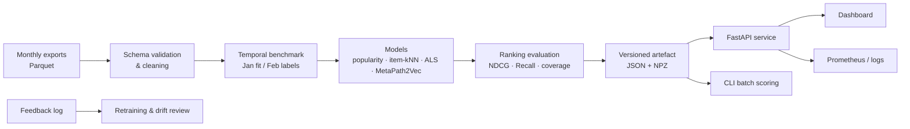

# EngageGraph

**Reproducible app-engagement analytics and next-app recommendation — built to be operated, not just demonstrated.**

[](https://github.com/cxy2696/app-engagement/actions/workflows/ci.yml)
[](https://github.com/cxy2696/app-engagement/releases)
[](https://www.python.org/)
[](LICENSE)
[](DATA_LICENSE.md)

EngageGraph turns panel-scale app-usage exports into a **leakage-free temporal benchmark**, a set of **honest baselines**, and a **servable recommendation API** with a human-readable dashboard. It is the maintained successor to the original `app-engagement` research notebook.

> **What changed.** The original notebook reported ROC-AUC 0.9257 from a transductive February setup with similarity-selected negatives, a broken cosine read-out, and no temporal ranking evaluation. EngageGraph replaces that with a January → February ranking protocol, full-catalogue seen-item masking, paired bootstrap confidence intervals, and an explicit audit of why the old number is not comparable. See [`reports/legacy-audit.md`](reports/legacy-audit.md).


## Why this repository exists

App-engagement teams need to answer a deceptively simple question: **which app will this user adopt next month, and why?** A notebook can produce a number; an operable product needs much more:

| Research notebook | EngageGraph |
| --- | --- |
| One monolithic notebook | Typed package, CLI, API, and dashboard |
| February edges used for fitting and testing | January fit, February labels only |
| Balanced AUC with hand-picked negatives | Full-catalogue ranking with seen-item masking |
| No uncertainty | Paired bootstrap CIs and Holm-corrected tests |
| Pickled model blobs | Versioned, pickle-free artefacts with dataset fingerprints |
| No failure handling | Cold-start fallback, health checks, metrics, runbooks |
| No data documentation | Data card, model card, and licence boundaries |

## Quickstart

### 1. Install

```bash
git clone https://github.com/cxy2696/app-engagement.git
cd app-engagement
python -m venv .venv && source .venv/bin/activate
pip install -e ".[dev,als,plots]"
```

Python 3.10+ is supported. The graph model is optional:

```bash
pip install -e ".[graph]"
```

### 2. Build the benchmark

The repository already contains the January/February aggregated exports under `Jan-Feb-parquet/`.

```bash
engagegraph data build \
  --jan Jan-Feb-parquet/jan_aggregated.parquet \
  --feb Jan-Feb-parquet/feb_aggregated.parquet \
  --out data/processed
```

This applies the published filtering protocol: apps with ≥10 January users, users with ≥3 catalogue apps, a 10,000-item cap, and a 99.9th-percentile weight clip before `log1p`.

### 3. Reproduce the benchmark

```bash
engagegraph benchmark --config configs/benchmark.yaml
```

This fits popularity, item-kNN, implicit ALS, and (when installed) MetaPath2Vec on the same January matrix, evaluates all of them on February, writes artefacts under `artifacts/runs/`, and runs paired bootstrap comparisons against popularity.

For a single model:

```bash
engagegraph train --config configs/als.yaml
```

### 4. Serve the API and dashboard

```bash
engagegraph serve --artifact artifacts/runs/<run>/artifact --port 8000
```

Open <http://127.0.0.1:8000> for the dashboard, <http://127.0.0.1:8000/docs> for OpenAPI, and <http://127.0.0.1:8000/metrics> for Prometheus text.

```bash
curl "http://127.0.0.1:8000/v1/users/<panelist-id>/recommendations?k=5"
```

## Results

<!-- RESULTS_TABLE_START -->
| Model | NDCG@10 (95% CI) | Recall@10 | MAP@10 | Coverage@10 | Novelty@10 |
| --- | ---: | ---: | ---: | ---: | ---: |
| `itemknn` | **0.2685** [0.2660, 0.2710] | 0.1522 | 0.1516 | 0.013 | 1.107 |
| `popularity` | **0.2351** [0.2327, 0.2376] | 0.1347 | 0.1297 | 0.006 | 1.055 |
| `metapath2vec` | **0.1639** [0.1622, 0.1660] | 0.0933 | 0.0772 | 0.015 | 1.661 |
| `als` | **0.0993** [0.0974, 0.1013] | 0.0798 | 0.0505 | 0.317 | 4.830 |

Dataset fingerprint: `a84b20b180409390ea2b` · Primary metric: `ndcg@10` · Evaluation users: 28,286 · Cold-start users: 10,875. Paired bootstrap intervals (1,000 resamples) are computed over evaluation users.
<!-- RESULTS_TABLE_END -->

**Technical report:** [EngageGraph (PDF)](paper/engagegraph-report.pdf) · **Evaluation report:** [reports/evaluation-report.md](reports/evaluation-report.md) · **Legacy audit:** [reports/legacy-audit.md](reports/legacy-audit.md)

The primary metric is **NDCG@10** over the full January catalogue with seen apps masked. Relevance is binary February adoption. Confidence intervals are paired user-level bootstrap intervals (1,000 resamples); p-values are Holm-corrected across models. Full protocol: [`docs/evaluation.md`](docs/evaluation.md).

## Architecture



Design rationale and extension points: [`docs/architecture.md`](docs/architecture.md).

## The protocol in one paragraph

January is the only month used to fit mappings, catalogue statistics, popularity, item similarities, and model parameters. February is used once, to construct labels: a test label is a February interaction with an app the user did **not** use in January. Candidates are the full January catalogue (apps with ≥10 January users), and all January apps are masked at scoring time. This measures **next-month new-app discovery**, not repeat usage. Users with no February adoption are excluded from the ranking denominator but counted in the data card. February users absent from January are reported as a cold-start slice.

## Operational features

- **Self-contained artefacts** — JSON manifest, NumPy arrays, mappings, and January history; no pickle.
- **Cold-start fallback** — unknown users receive popularity recommendations with `strategy="cold_start_popularity"`.
- **Explanations** — every recommendation carries the strongest January co-usage reasons.
- **Feedback capture** — append-only JSONL impressions/clicks for future online evaluation.
- **Health & metrics** — `/healthz`, `/readyz`, `/metrics`, request IDs, latency headers.
- **Docker** — non-root image with a health check; `compose.yaml` for one-command deployment.
- **CI** — lint, type checks, unit/integration tests, package build, and a graph-model job.
- **Runbooks** — retraining, drift review, incident response, and rollback in [`docs/operations.md`](docs/operations.md).

## Repository layout

```text
src/engagegraph/          # package: data, models, evaluation, API, CLI
tests/                    # fast unit tests + synthetic integration tests
configs/                  # reproducible experiment configurations
docs/                     # methodology, data/model cards, deployment, operations
paper/                    # LaTeX technical report and bibliography
reports/                  # generated evaluation report and figures
scripts/                  # data fetch, demo bootstrap, report/figure generation
Jan-Feb-parquet/          # original aggregated exports (research use only)
```

## Documentation

| Document | What it covers |
| --- | --- |
| [Methodology](docs/methodology.md) | Formal task, estimators, leakage controls, statistical analysis |
| [Evaluation](docs/evaluation.md) | Exact protocol, commands, metric definitions |
| [Data card](docs/data-card.md) | Provenance, schema, quality issues, intended use, ethics |
| [Model card](docs/model-card.md) | Intended use, factors, metrics, limitations |
| [Architecture](docs/architecture.md) | Components, data flow, design decisions |
| [API](docs/api.md) | Endpoints, examples, error semantics |
| [Deployment](docs/deployment.md) | Local, Docker, reverse proxy, configuration |
| [Operations](docs/operations.md) | SLOs, monitoring, retraining, incident runbook |
| [Reproducibility](docs/reproducibility.md) | Seeds, fingerprints, expected outputs, CI |
| [Governance](docs/governance.md) | Change control, releases, data ethics |
| [中文说明](README.zh-CN.md) | 中文快速开始与项目说明 |

## Data and licence

Code is released under the [Apache License 2.0](LICENSE). The panel data in `Jan-Feb-parquet/` is **not** covered by that licence and is provided for research reproducibility only; see [`DATA_LICENSE.md`](DATA_LICENSE.md). The exports are pseudonymous but remain potentially re-identifiable; do not attempt re-identification, and do not deploy the demo on public panelist IDs without access controls.

The weight column is inferred to be **milliseconds** from its distribution; this is documented as an inference, not a codebook fact. See the [data card](docs/data-card.md).

## Citation

If you use the benchmark, code, or report, please cite:

```bibtex
@software{engagegraph2026,
  author  = {Cui, Xinyi},
  title   = {EngageGraph: A Reproducible Benchmark and Toolkit for Temporal App-Engagement Prediction},
  year    = {2026},
  version = {2.0.0},
  url     = {https://github.com/cxy2696/app-engagement}
}
```

The graph model implements the metapath2vec objective from Dong et al. (KDD 2017); the implicit ALS baseline follows Hu, Koren & Volinsky (2008). Full references are in [`paper/refs.bib`](paper/refs.bib).

## Contributing and maintenance

Issues and pull requests are welcome. Start with [`CONTRIBUTING.md`](CONTRIBUTING.md), follow the [Code of Conduct](CODE_OF_CONDUCT.md), and report security issues privately per [`SECURITY.md`](SECURITY.md). The maintenance policy, release cadence, and deprecation rules are in [`GOVERNANCE.md`](GOVERNANCE.md).

**Maintainer:** Xinyi Cui ([@cxy2696](https://github.com/cxy2696)).
