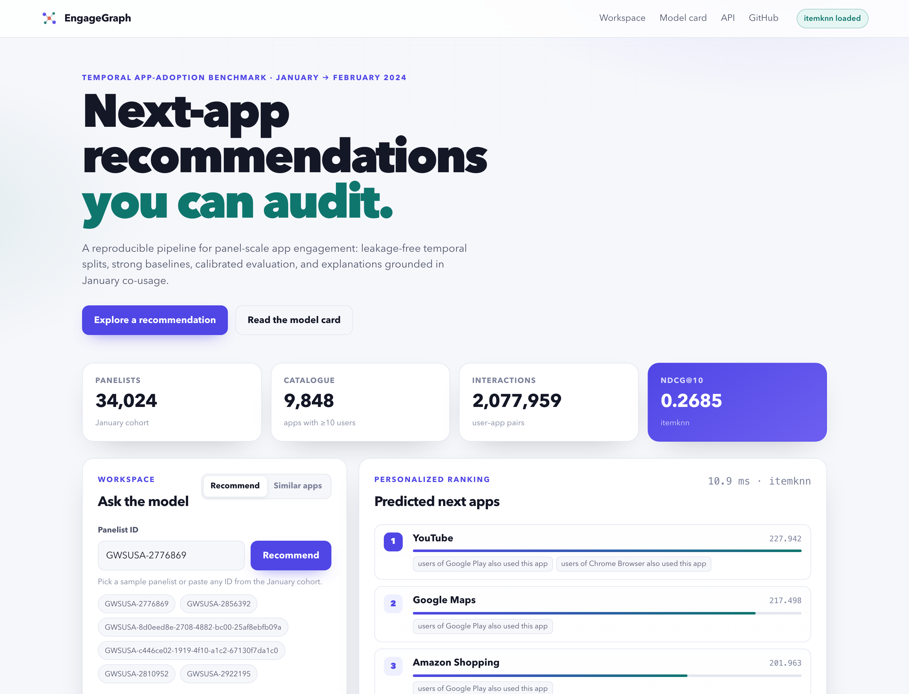

# EngageGraph

Temporal next-item recommendation on panel data: a reproducible benchmark, four reference models, and a deployable API with a dashboard.

[](https://github.com/cxy2696/app-engagement/actions/workflows/ci.yml)
[](https://github.com/cxy2696/app-engagement/releases)
[](https://www.python.org/)
[](LICENSE)
[](DATA_LICENSE.md)

[Showcase](docs/showcase.md) · [Technical report](paper/engagegraph-report.pdf) · [Evaluation](reports/evaluation-report.md) · [Verification](docs/reproducibility.md#6-verification) · [Release](https://github.com/cxy2696/app-engagement/releases)



## What this is

EngageGraph fits a model on one period and ranks items a user has not used before, for the next period. The reference dataset is a pseudonymous January–February 2024 mobile-app panel. The engine, evaluation, artefact format, and API work on any user × item interaction table; apps are a profile, not an assumption.

The original notebook reported ROC-AUC 0.9257 from February edges with similarity-selected negatives and a broken cosine read-out. Those choices do not estimate next-period ranking quality. The [legacy audit](reports/legacy-audit.md) documents the differences; this repository does not reuse the number.

## Quickstart

```bash
git clone https://github.com/cxy2696/app-engagement.git
cd app-engagement
python -m venv .venv && source .venv/bin/activate
pip install -e ".[dev,als,plots]"      # add ".[graph]" for MetaPath2Vec

engagegraph data build --config configs/dataset.yaml --out data/processed
engagegraph benchmark --config configs/benchmark.yaml
engagegraph serve --artifact artifacts/runs/<run>/artifact --port 8000
```

Dashboard: <http://127.0.0.1:8000> · OpenAPI: `/docs` · Prometheus text: `/metrics`. Dashboard state is shareable (`?user=...&k=10&min_percentile=0.9`), and each row can open similar items.

The shortcut is:

```bash
make demo && make serve
```

## Protocol

January 2024 is used to fit every mapping, catalogue statistic, popularity score, similarity matrix, and model parameter. February 2024 is used once, to label a user–item pair positive if the item is in the January catalogue and the user did not use it in January. At scoring time all January items are masked. The primary metric is NDCG@10, macro-averaged over users; confidence intervals are paired user-level bootstrap intervals (1,000 resamples), with Holm correction across model comparisons.

Users with no January history (10,568) are a cold-start slice. Users with fewer than three catalogue items in January (307) are ineligible and are reported separately; neither group is silently mixed into the personalised denominator. Full protocol: [docs/evaluation.md](docs/evaluation.md) and [docs/methodology.md](docs/methodology.md).

## Reference result

<!-- RESULTS_TABLE_START -->
| Model | NDCG@10 (95% CI) | Recall@10 | MAP@10 | Coverage@10 | Novelty@10 |
| --- | ---: | ---: | ---: | ---: | ---: |
| `itemknn` | **0.2685** [0.2660, 0.2710] | 0.1522 | 0.1516 | 0.013 | 1.107 |
| `popularity` | **0.2351** [0.2327, 0.2376] | 0.1347 | 0.1297 | 0.006 | 1.055 |
| `metapath2vec` | **0.1639** [0.1622, 0.1660] | 0.0933 | 0.0772 | 0.015 | 1.661 |
| `als` | **0.0993** [0.0974, 0.1013] | 0.0798 | 0.0505 | 0.317 | 4.830 |

Dataset fingerprint: `dca196daee55783bae1c` · Primary metric: `ndcg@10` · Evaluation users: 28,286 · Cold-start users: 10,568. Paired bootstrap intervals (1,000 resamples) are computed over evaluation users.
<!-- RESULTS_TABLE_END -->

The winner is item-kNN, not the graph model that motivated the original repository. ALS and MetaPath2Vec are reported with their coverage/novelty trade-offs rather than tuned away. See the [evaluation report](reports/evaluation-report.md) for intervals, Holm-corrected comparisons, and per-K metrics.

## One engine, several domains

A `domain` block supplies vocabulary and an optional serving blocklist; it does not enter the model or the metric.

```yaml
data:
  train_path: data/your_domain/train.parquet
  test_path: data/your_domain/test.parquet
  user_col: customer_id
  item_col: sku
  weight_col: revenue
  domain:
    name: ecommerce
    user_label: customer
    item_label: product
    item_label_plural: products
    task_name: next-period product adoption ranking
    blocklist: []
```

Profiles: [generic retail CSV](profiles/generic-interactions.yaml) (synthetic example), [e-commerce template](profiles/ecommerce.example.yaml), and the [app reference config](configs/benchmark.yaml). Details: [docs/generality.md](docs/generality.md).

```bash
engagegraph data build --config profiles/generic-interactions.yaml --out data/processed-generic
engagegraph benchmark --config profiles/generic-interactions.yaml
```

## Layout

```text
src/engagegraph/   package: data, models, evaluation, API, CLI
tests/             unit, integration, and mathematical invariant tests
configs/           canonical experiment configs
profiles/          domain profiles and templates
docs/              protocol, data/model cards, deployment, operations
paper/             LaTeX technical report and PDF
reports/           generated evaluation, audit, and verification reports
scripts/           data fetch, demo, report, screenshot, verification
Jan-Feb-parquet/   original aggregated exports (research use only)
```

## Documentation

| Document | Contents |
| --- | --- |
| [Methodology](docs/methodology.md) | Task, estimators, leakage controls, statistics |
| [Algorithm notes](docs/algorithm.md) | Item-kNN scoring, percentiles, decision policy |
| [Evaluation](docs/evaluation.md) | Commands and metric definitions |
| [Reproducibility](docs/reproducibility.md) | Seeds, fingerprints, CI, verification |
| [Data card](docs/data-card.md) | Provenance, schema, quality, privacy |
| [Model card](docs/model-card.md) | Use, metrics, limitations |
| [Generality](docs/generality.md) | Adapting to another catalogue |
| [Architecture](docs/architecture.md) | Components and extension points |
| [API](docs/api.md) | Endpoints and examples |
| [Deployment](docs/deployment.md) | Docker, proxy, configuration |
| [Operations](docs/operations.md) | SLOs, monitoring, retraining, incidents |
| [Showcase](docs/showcase.md) | Screens, links, reference result |
| [Glossary](docs/glossary.md) | Terms and symbols |
| [Governance](docs/governance.md) | Change control and releases |
| [中文说明](README.zh-CN.md) | 中文快速开始 |

## Data and licence

Code is Apache-2.0. The panel exports in `Jan-Feb-parquet/` are **not** covered by that licence and are included for research reproducibility only; see [DATA_LICENSE.md](DATA_LICENSE.md). The identifiers are pseudonymous but potentially re-identifiable. Do not attempt re-identification or publish per-panelist records. The weight unit is inferred to be milliseconds from its distribution, not from a vendor codebook; see the [data card](docs/data-card.md).

## Citation and maintenance

```bibtex
@software{engagegraph2026,
  author  = {Cui, Xinyi},
  title   = {EngageGraph: A Reproducible Benchmark and Toolkit for Temporal App-Engagement Prediction},
  year    = {2026},
  version = {2.3.0},
  url     = {https://github.com/cxy2696/app-engagement}
}
```

Maintainer: Xinyi Cui, [xc535@cornell.edu](mailto:xc535@cornell.edu). Issues and pull requests are welcome; read [CONTRIBUTING.md](CONTRIBUTING.md) first. Security reports follow [SECURITY.md](SECURITY.md). Release and change policy: [GOVERNANCE.md](GOVERNANCE.md).
