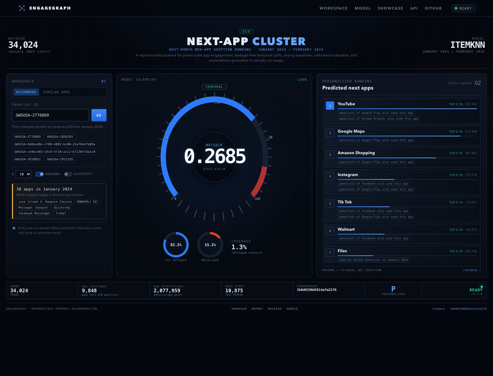

# EngageGraph

**可复现、可运营的时序参与度分析与“下一个物品”推荐系统，附带应用参与度参考基准。**

[](https://github.com/cxy2696/app-engagement/actions/workflows/ci.yml)
[](https://github.com/cxy2696/app-engagement/releases)
[](https://www.python.org/)
[](LICENSE)
[](DATA_LICENSE.md)

**[展示页](docs/showcase.md)** · **[技术报告](paper/engagegraph-report.pdf)** · **[评估报告](reports/evaluation-report.md)** · **[Release](https://github.com/cxy2696/app-engagement/releases)**

EngageGraph 是原 `app-engagement` 研究 notebook 的工程化升级版：把 2024 年 1–2 月的面板应用使用数据，变成**无泄漏的时序基准、可解释的基线模型、可部署的推荐 API 与仪表盘**。

> **重要更正。** 原 notebook 报告的 ROC-AUC 0.9257 来自 2 月的直推式（transductive）设置、按相似度挑选的负样本，以及一个实现有误的 cosine 读出；它不能作为推荐质量指标。EngageGraph 用“1 月训练、2 月只做标签”的全目录排序协议替代它，并公开审计旧结果为何不可比。详见 [`reports/legacy-audit.md`](reports/legacy-audit.md)。



## 为什么需要这个项目

一个 notebook 可以给出一个数字；一个可运营的产品还需要：

| 研究 notebook | EngageGraph |
| --- | --- |
| 单文件、难以维护 | 类型化 Python 包 + CLI + API + 仪表盘 |
| 2 月数据参与拟合与测试 | 仅 1 月拟合，2 月只构造标签 |
| 平衡负样本 AUC | 全目录排序、已用应用掩码 |
| 无置信区间 | 配对 bootstrap + Holm 校正 |
| pickle 模型 | 无 pickle、带数据集指纹的版本化 artefact |
| 无冷启动/健康检查 | 流行度回退、`/healthz`、Prometheus 指标、运维手册 |
| 无数据说明 | 数据卡、模型卡、许可边界 |

## 快速开始

```bash
git clone https://github.com/cxy2696/app-engagement.git
cd app-engagement
python -m venv .venv && source .venv/bin/activate
pip install -e ".[dev,als,plots]"

# 1. 构建基准（仓库已包含 Jan-Feb-parquet/）
engagegraph data build --out data/processed

# 2. 复现实验
engagegraph benchmark --config configs/benchmark.yaml

# 3. 启动 API 与仪表盘
engagegraph serve --artifact artifacts/runs/<run>/artifact --port 8000
```

打开 <http://127.0.0.1:8000>；OpenAPI 文档在 `/docs`，指标在 `/metrics`。

## 评估协议（一句话）

1 月是唯一用于拟合映射、目录、流行度、相似度和模型参数的月份；2 月只用于构造标签：**用户在 2 月使用、但 1 月未使用的目录内应用**才算命中。候选集是完整的 1 月目录，评分时屏蔽用户 1 月已用应用。主指标为 **NDCG@10**，按用户宏平均；置信区间为用户级配对 bootstrap；冷启动用户单独报告。

完整定义、公式和泄漏控制见 [`docs/methodology.md`](docs/methodology.md)。

## 一个引擎，多个领域

应用只是参考数据集，不是硬编码假设。模型、评估、artefact 与 API 都基于通用的
用户 × 物品交互矩阵；`domain` 配置只负责领域词汇、文件布局与可选的 serving
blocklist。

```yaml
data:
  train_path: data/your_domain/train.parquet
  test_path: data/your_domain/test.parquet
  user_col: customer_id
  item_col: sku
  weight_col: revenue
  domain:
    name: ecommerce
    user_label: customer
    item_label: product
    item_label_plural: products
    task_name: next-period product adoption ranking
    train_period_label: last quarter
    test_period_label: current quarter
    blocklist: []
```

`/v1/meta` 会返回领域标签，仪表盘自动切换文案；评估协议与运维方式不变。
详见 [`docs/generality.md`](docs/generality.md) 与 [`profiles/`](profiles/)
（应用、通用 CSV 零售示例、电商模板）。

```bash
engagegraph data build --config profiles/generic-interactions.yaml --out data/processed-generic
engagegraph benchmark --config profiles/generic-interactions.yaml
```

## 结果

<!-- RESULTS_TABLE_START -->
| Model | NDCG@10 (95% CI) | Recall@10 | MAP@10 | Coverage@10 | Novelty@10 |
| --- | ---: | ---: | ---: | ---: | ---: |
| `itemknn` | **0.2685** [0.2660, 0.2710] | 0.1522 | 0.1516 | 0.013 | 1.107 |
| `popularity` | **0.2351** [0.2327, 0.2376] | 0.1347 | 0.1297 | 0.006 | 1.055 |
| `metapath2vec` | **0.1639** [0.1622, 0.1660] | 0.0933 | 0.0772 | 0.015 | 1.661 |
| `als` | **0.0993** [0.0974, 0.1013] | 0.0798 | 0.0505 | 0.317 | 4.830 |

Dataset fingerprint: `2b8d9290d5614afa22f6` · Primary metric: `ndcg@10` · Evaluation users: 28,286 · Cold-start users: 10,875. Paired bootstrap intervals (1,000 resamples) are computed over evaluation users.
<!-- RESULTS_TABLE_END -->

**技术报告：** [EngageGraph（PDF）](paper/engagegraph-report.pdf) · **评估报告：** [reports/evaluation-report.md](reports/evaluation-report.md) · **旧结果审计：** [reports/legacy-audit.md](reports/legacy-audit.md)

## 主要能力

- **可复现**：配置、数据指纹、随机种子、依赖锁文件、artefact 清单。
- **可解释**：每条推荐附带 1 月共使用理由；item-kNN 的解释是精确的邻居贡献。
- **可运营**：冷启动回退、批量打分、反馈日志、健康检查、Prometheus 指标、Docker、CI、重训练与回滚手册。
- **学术严谨**：时序切分、全目录排序、配对显著性检验、覆盖率/新颖度、旧结果审计、数据与模型卡。

## 目录结构

```text
src/engagegraph/     核心包：数据、模型、评估、API、CLI
tests/               合成数据单元/集成测试
configs/             可复现实验配置
docs/                方法、数据卡、模型卡、部署、运维
paper/               LaTeX 技术报告
reports/             生成的评估报告与图表
scripts/             数据获取、演示构建、报告/图表脚本
Jan-Feb-parquet/     原始聚合数据（仅限研究复现）
```

## 文档

| 文档 | 内容 |
| --- | --- |
| [`docs/methodology.md`](docs/methodology.md) | 任务定义、模型、评估、统计、泄漏控制 |
| [`docs/algorithm.md`](docs/algorithm.md) | 打分、百分位、决策策略、复杂度 |
| [`docs/evaluation.md`](docs/evaluation.md) | 复现命令与指标解释 |
| [`docs/data-card.md`](docs/data-card.md) | 数据来源、字段、质量、隐私、许可 |
| [`docs/model-card.md`](docs/model-card.md) | 适用范围、指标、局限、伦理 |
| [`docs/architecture.md`](docs/architecture.md) | 架构与扩展点 |
| [`docs/api.md`](docs/api.md) | API 端点与示例 |
| [`docs/deployment.md`](docs/deployment.md) | 本地、Docker、反向代理 |
| [`docs/operations.md`](docs/operations.md) | SLO、监控、重训练、事故手册 |
| [`docs/showcase.md`](docs/showcase.md) | 截图、链接与参考结果 |
| [`docs/generality.md`](docs/generality.md) | 适配电商、内容、SaaS 等其他领域 |
| [`docs/reproducibility.md`](docs/reproducibility.md) | 种子、指纹、CI、已知不可复现因素 |
| [`docs/governance.md`](docs/governance.md) | 变更控制、发布、数据伦理 |

## 数据与许可

代码使用 [Apache License 2.0](LICENSE)。`Jan-Feb-parquet/` 中的数据**不适用**该许可，仅用于研究复现；详见 [`DATA_LICENSE.md`](DATA_LICENSE.md)。数据虽为假名化 ID，仍可能被再识别；禁止再识别、禁止与外部数据连接、禁止公开个人级记录。

权重单位根据分布推断为**毫秒**，并非厂商 codebook 的事实；不要据此报告绝对时长。

## 引用

```bibtex
@software{engagegraph2026,
  author  = {Cui, Xinyi},
  title   = {EngageGraph: A Reproducible Benchmark and Toolkit for Temporal App-Engagement Prediction},
  year    = {2026},
  version = {2.2.0},
  url     = {https://github.com/cxy2696/app-engagement}
}
```

## 维护

问题与 PR 欢迎提交。请先阅读 [`CONTRIBUTING.md`](CONTRIBUTING.md)、[`CODE_OF_CONDUCT.md`](CODE_OF_CONDUCT.md)、[`SECURITY.md`](SECURITY.md) 与 [`GOVERNANCE.md`](GOVERNANCE.md)。

维护者：Xinyi Cui（[@cxy2696](https://github.com/cxy2696)）。
