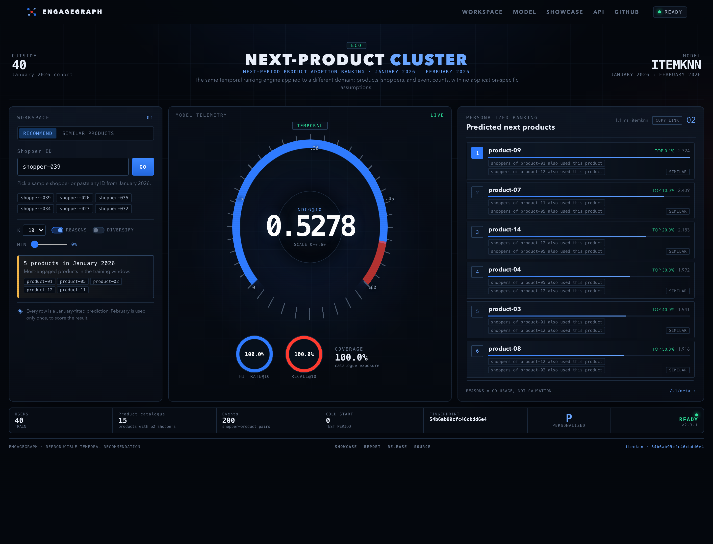

# Adapting EngageGraph to another domain

EngageGraph is a **temporal next-item ranking engine**, not an app-specific
application. Apps are the reference dataset, but the same matrices, models,
artefact format, API, and evaluation apply to products, articles, videos,
courses, SaaS features, or any other item catalogue.

This guide explains the boundary between the domain-agnostic engine and the
small amount of configuration that makes it feel native to a domain.

## 1. What is domain-agnostic

- **Data structure:** a sparse user × item interaction matrix, fitted on a
  training period and evaluated on a later test period.
- **Models:** popularity, item-kNN, implicit ALS, and MetaPath2Vec operate on
  IDs and weights; they never read labels such as "app".
- **Evaluation:** full-catalogue ranking with seen items masked, macro-averaged
  NDCG/Recall/MAP/HitRate, paired bootstrap, coverage/novelty.
- **Artefacts:** JSON manifest, NumPy arrays, mappings, and the training
  history. No domain-specific code is serialized.
- **Serving:** `/v1/users/{id}/recommendations`, `/v1/popular`,
  `/v1/items/similar`, batch scoring, feedback, and health endpoints.

## 2. What is domain-specific

| Concern | Where it lives |
| --- | --- |
| Vocabulary (`app`, `product`, `article`) | `data.domain` / profile |
| Optional serving blocklist | `data.domain.blocklist` |
| File locations and column names | `data.train_path`, `data.test_path`, `data.*_col` |
| Weight semantics and transform | `data.weight_col`, `data.weight_unit`, `data.weight_transform` |
| Catalogue support thresholds | `data.min_item_users`, `data.min_user_items`, `data.max_items` |
| Task statement | `data.domain.task_name` (labels only; the metric stays ranking) |

The domain block is stored in the dataset manifest and carried into every
artefact, so the API and dashboard can render the right vocabulary without
code changes.

## 3. Data contract

Provide two tables (or two periods) with one row per interaction:

| Column | Required | Meaning |
| --- | --- | --- |
| user identifier | yes | Any string; hashed/pseudonymous IDs are preferred |
| item identifier | yes | Any string; app names, SKUs, article IDs |
| weight | no | Engagement, revenue, count, or duration; defaults to 1 per row |
| timestamp | no | Accepted and ignored for aggregation; useful for provenance |

Supported formats: Parquet, CSV/TSV, JSONL. Duplicate `(user, item)` rows are
summed. The cleaner records every dropped row in a quality report.

A label is a test-period interaction with an item that is **in the training
catalogue** and was **not used by that user in training**. This is a new-item
adoption task. If your product needs repeat usage, purchase counts, or session
ranking, that is a different task and should not be reported with these
numbers.

## 4. Minimal generic example

```bash
engagegraph data build --config configs/profiles/generic-interactions.yaml --out data/processed-generic
engagegraph benchmark --config configs/profiles/generic-interactions.yaml
engagegraph serve --artifact artifacts/runs/generic/<run>/artifact --port 8001
```

The synthetic example uses:

```yaml
data:
  train_path: configs/examples/generic/train.csv
  test_path: configs/examples/generic/test.csv
  format: csv
  user_col: user_id
  item_col: item_id
  weight_col: event_count
  time_col: event_time
  weight_unit: count
  min_item_users: 2
  min_user_items: 2
  max_items: null
  weight_transform: log1p
  domain:
    name: generic-retail
    user_label: shopper
    user_label_plural: shoppers
    item_label: product
    item_label_plural: products
    interaction_label: event
    catalog_label: product catalogue
    task_name: next-period product adoption ranking
    train_period_label: January 2026
    test_period_label: February 2026
    blocklist: []
```

Swap the paths and labels for your data. For a binary interaction table, set
`weight_col: null`; the pipeline creates unit weights.

Set a profile-level `processed_dir` (for example
`data/processed-generic`) so two domains never overwrite each other's processed
benchmark. `engagegraph data build --config <profile> --out ...` selects the output
directory explicitly. Do not share `data/processed` between domains.

## 5. Domain examples

### E-commerce

- `user_label: customer`, `item_label: product`, `interaction_label: purchase`.
- Weight: revenue or purchase count; consider `log1p` to compress heavy buyers.
- Blocklist: discontinued SKUs, internal test products, or items with legal
  restrictions.
- Avoid using the benchmark to claim repurchase lift; it measures new-product
  adoption, not repeat purchase.

### Content / media

- `user_label: reader` or `viewer`, `item_label: article` or `video`.
- Weight: watch/read seconds; clip extreme sessions.
- Cold items are common; report catalogue coverage and cold-start users.
- Popularity is a strong baseline for news; add recency features before
  claiming personalisation.

### SaaS / product features

- `user_label: account`, `item_label: feature`.
- Weight: usage events or active days.
- Be careful with shared accounts and organisational seats; the "user" may be
  a team, not an individual.
- A feature-adoption label is not a business outcome; do not present it as
  revenue impact.

## 6. Serving metadata

`GET /v1/meta` returns:

```json
{
  "domain": {"name": "retail", "item_label": "product", "item_label_plural": "products"},
  "labels": {"user": "shopper", "item": "product", "train_period": "January 2026"},
  "serving_blocklist_size": 1
}
```

Canonical endpoints use `item` (`/v1/items/similar`); `/v1/apps/similar` is a
backwards-compatible alias. `GET /v1/users/{id}` returns both generic
`n_items`/`top_items` and legacy `n_apps`/`top_apps` keys.

The dashboard reads the domain block and updates its labels automatically.



The screenshot above is the synthetic retail profile: shoppers, products, event
counts, a different support threshold, and no app blocklist. No frontend code
changed between the two screenshots.

## 7. Checklist for a new domain

- [ ] Choose a task name that matches the decision (adoption, next purchase,
      next lesson), and state that the metric is binary ranking.
- [ ] Confirm the training catalogue is fixed before the test period.
- [ ] Decide whether a blocklist is needed for non-actionable items.
- [ ] Inspect the data-quality report: missing IDs, extreme weights, duplicates.
- [ ] Report cold-start users/items and catalogue coverage, not only NDCG.
- [ ] Validate on your own first-party data before claiming business impact.
- [ ] Review the data licence and privacy constraints for the new dataset.

## 8. What does *not* transfer automatically

- The app panel's blocklist and millisecond weight assumption are
  app-specific; both live in the app profile, not the engine.
- The absolute NDCG values are panel- and month-specific. Transfer the
  protocol and baselines, not the number.
- Explanations are co-usage based. They are not causal and do not know product
  categories or content semantics.
- The engine has no demographic fairness audit because the reference data has
  no demographics. Add one for your domain if you have the data and the legal
  basis.
