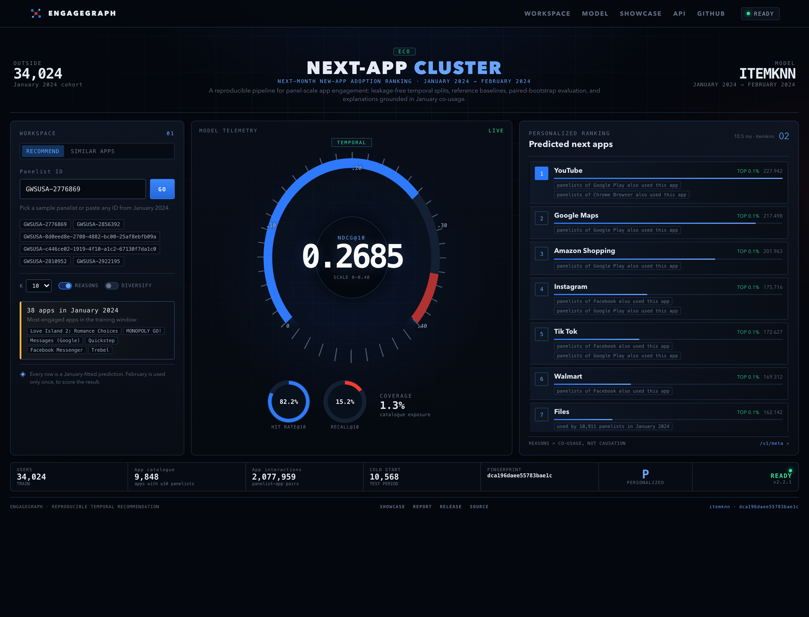
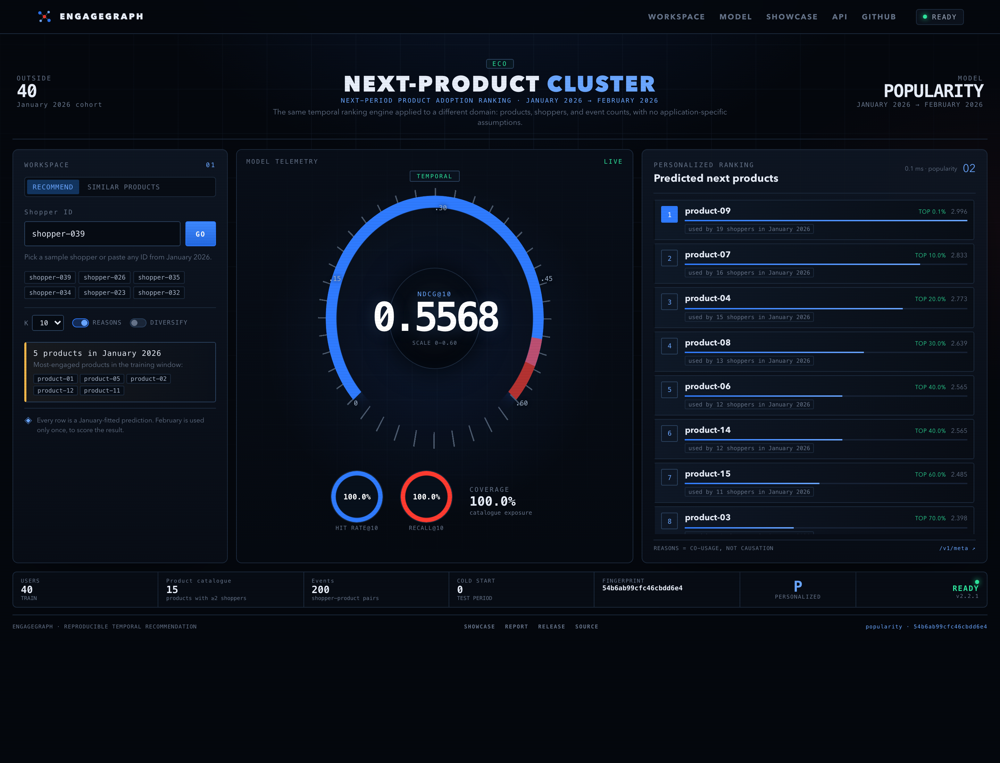

# Showcase

Screenshots, links, and the reference result for EngageGraph.

## Links

| Destination | Link |
| --- | --- |
| Repository | <https://github.com/cxy2696/app-engagement> |
| Releases | <https://github.com/cxy2696/app-engagement/releases> |
| Technical report | [paper/engagegraph-report.pdf](../paper/engagegraph-report.pdf) |
| Evaluation report | [reports/evaluation-report.md](../reports/evaluation-report.md) |
| Legacy AUC audit | [reports/legacy-audit.md](../reports/legacy-audit.md) |
| Reproducibility verification | [reports/verification.md](../reports/verification.md) |
| API documentation | <http://127.0.0.1:8000/docs> |
| Generality guide | [generality.md](generality.md) |
| Domain profiles | [profiles/](../profiles/) |

## App-engagement reference



## Same engine, retail domain



The second screen uses `profiles/generic-interactions.yaml`: 40 synthetic shoppers, 15 products, event counts, and no app blocklist. Only the domain configuration differs from the first screen.

## Reference result

| Model | NDCG@10 (95% CI) | Recall@10 | Coverage@10 |
| --- | ---: | ---: | ---: |
| **item-kNN** | **0.2685 [0.2660, 0.2710]** | 0.1522 | 0.013 |
| Popularity | 0.2351 [0.2327, 0.2376] | 0.1347 | 0.006 |
| MetaPath2Vec | 0.1639 [0.1622, 0.1660] | 0.0933 | 0.015 |
| ALS | 0.0993 [0.0974, 0.1013] | 0.0798 | 0.317 |

Dataset fingerprint: `dca196daee55783bae1c`. 34,024 users × 9,848 apps; 28,286 evaluation users; 10,568 cold-start users; 307 ineligible users. See the [evaluation report](../reports/evaluation-report.md) for intervals and per-K metrics.

## Local run

```bash
make demo
make serve
# open http://127.0.0.1:8000
```

The screenshots are produced by `scripts/screenshot.py` against the running API. The app screen uses `artifacts/demo`; the retail screen uses the generic profile artefact.
