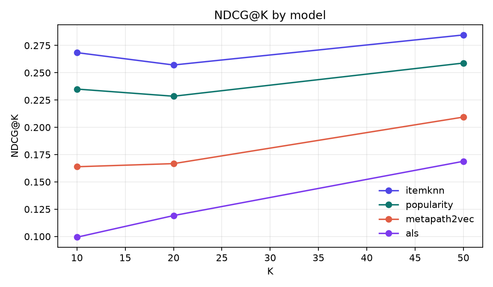
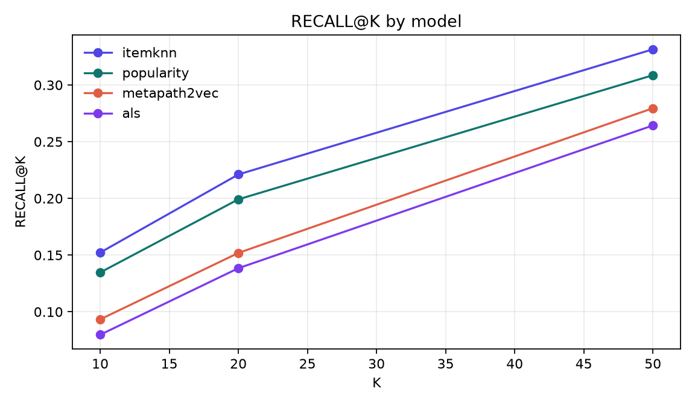
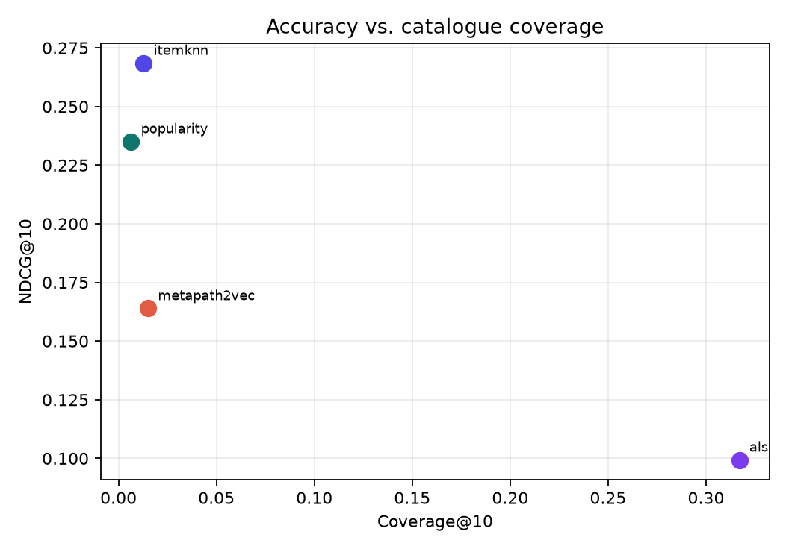
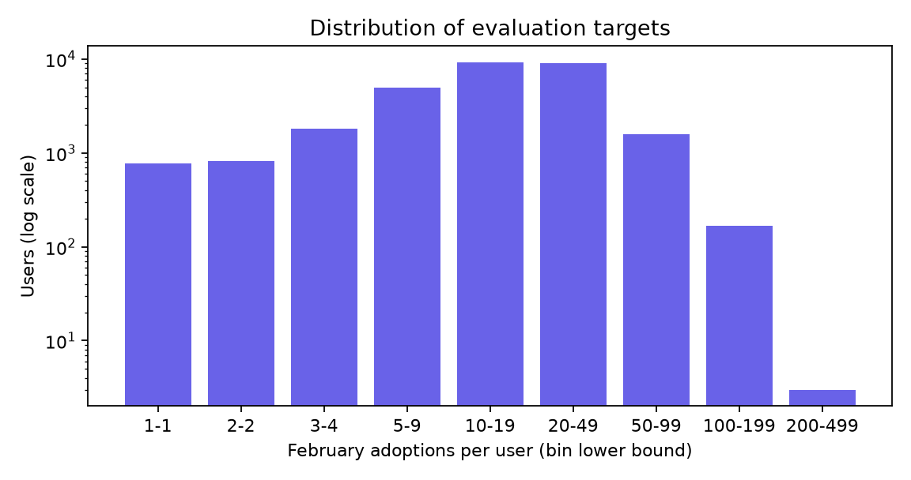
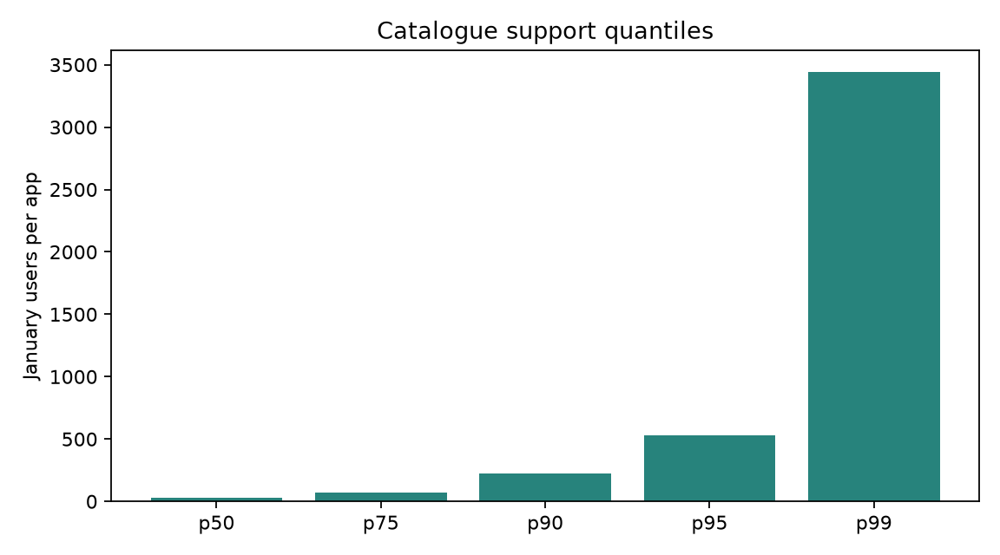

# EngageGraph evaluation report

Generated: 2026-11-11 22:09 UTC  
Dataset fingerprint: `cbe6c5226c51f160477f`  
Package: `2.3.1`  
Domain: `app-engagement`  
Primary metric: **NDCG@10**

## Headline

| Model | NDCG@10 (95% CI) | Recall@10 | MAP@10 | HitRate@10 | Coverage@10 | Novelty@10 |
| --- | ---: | ---: | ---: | ---: | ---: | ---: |
| `itemknn` | 0.2685 [0.2660, 0.2710] | 0.1522 | 0.1516 | 0.8221 | 0.013 | 1.107 |
| `popularity` | 0.2351 [0.2327, 0.2376] | 0.1347 | 0.1297 | 0.7723 | 0.006 | 1.055 |
| `metapath2vec` | 0.1639 [0.1622, 0.1660] | 0.0933 | 0.0772 | 0.6979 | 0.015 | 1.661 |
| `als` | 0.0993 [0.0974, 0.1013] | 0.0798 | 0.0505 | 0.4288 | 0.317 | 4.830 |

Coverage and novelty are included because accuracy alone can hide a degenerate popularity strategy. Confidence intervals are paired user-level bootstrap intervals over evaluation users (1,000 resamples, 95%).

## Paired comparisons

| Candidate vs. baseline | Δ NDCG@10 | 95% CI | p (bootstrap) | p (Holm) |
| --- | ---: | ---: | ---: | ---: |
| `itemknn` vs `popularity` | +0.0334 | [+0.0325, +0.0341] | 0.0020 | 0.0060 |
| `als` vs `popularity` | -0.1357 | [-0.1380, -0.1335] | 0.0020 | 0.0060 |
| `metapath2vec` vs `popularity` | -0.0712 | [-0.0731, -0.0692] | 0.0020 | 0.0060 |

`n = 28,286` evaluation panelists; `10,568` February 2024 cold-start panelists and `307` ineligible panelists are reported separately and are not in the personalised denominator.

## Per-K metrics

| Model | NDCG@10 | Recall@10 | NDCG@20 | Recall@20 | NDCG@50 | Recall@50 |
| --- | ---: | ---: | ---: | ---: | ---: | ---: |
| `popularity` | 0.2351 | 0.1347 | 0.2285 | 0.1992 | 0.2589 | 0.3086 |
| `itemknn` | 0.2685 | 0.1522 | 0.2571 | 0.2211 | 0.2846 | 0.3314 |
| `als` | 0.0993 | 0.0798 | 0.1192 | 0.1384 | 0.1689 | 0.2643 |
| `metapath2vec` | 0.1639 | 0.0933 | 0.1667 | 0.1519 | 0.2094 | 0.2795 |

## Dataset

- Panelists x apps: **34,024 x 9,848**
- Train interactions: **2,077,959**
- Test targets: **561,231**
- Targets per evaluation user: mean **19.8**, median **15**
- Catalogue coverage of February 2024 rows (warm panelists): **93.4%**
- Weight transform: `log1p`; clip: `2,159,359,336`

## Protocol recap

January 2024 is used for all fitting; February 2024 only defines binary adoption labels for apps the user did not use in January 2024. The candidate set is the full January 2024 catalogue, and all January 2024 items are masked at scoring time. Metrics are macro-averaged over users. Primary configurations were fixed before the test period; post-hoc MetaPath2Vec/item-kNN diagnostics are disclosed in docs/methodology.md §3.5.

Full details: [`docs/methodology.md`](../docs/methodology.md).

## Reading the result

The largest positive paired difference is `itemknn` over `popularity`: **+0.0334 NDCG@10** (Holm p = 0.0060). The interval excludes zero, so the difference is credible under this protocol, but it remains specific to this panel and month pair.

Coverage differences matter: a model with higher NDCG but near-zero coverage is recommending the same few apps to everyone. The `accuracy_vs_coverage` figure makes that trade-off explicit.

## Limitations

- One panel, one January 2024 -> February 2024 transition; no claim of generalisation to other markets.
- Binary relevance; graded engagement is out of scope for the primary metric.
- Offline evaluation; no position bias or online A/B evidence.
- The data licence is unresolved; see [`DATA_LICENSE.md`](../DATA_LICENSE.md).

## Reproduce

```bash
engagegraph data build --config configs/benchmark.yaml --out data/processed
engagegraph benchmark --config configs/benchmark.yaml
engagegraph report --benchmark artifacts/runs/benchmark.json --out reports
```

The legacy AUC audit is in [`legacy-audit.md`](legacy-audit.md).

## Figures











